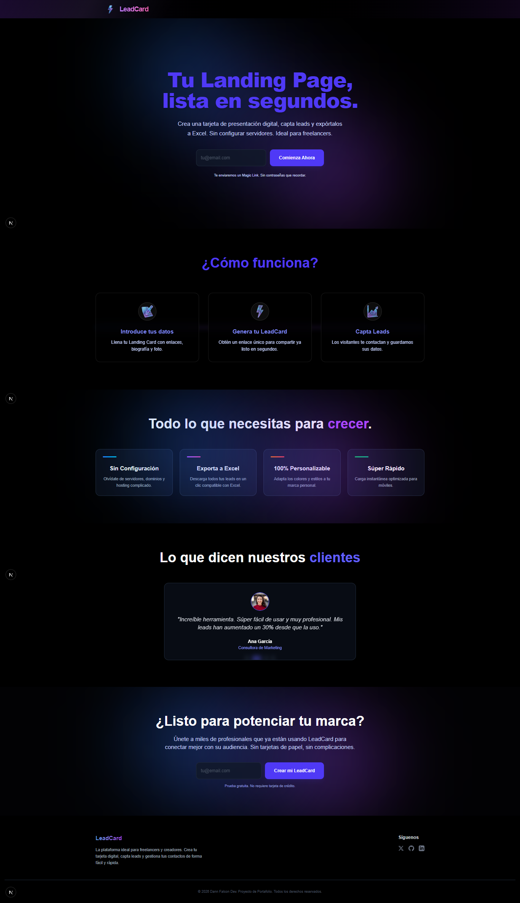
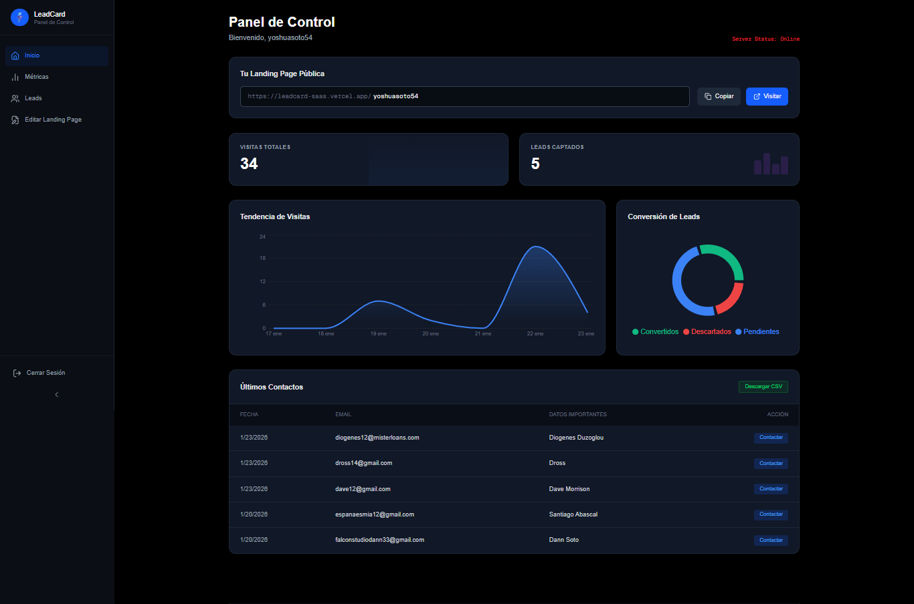
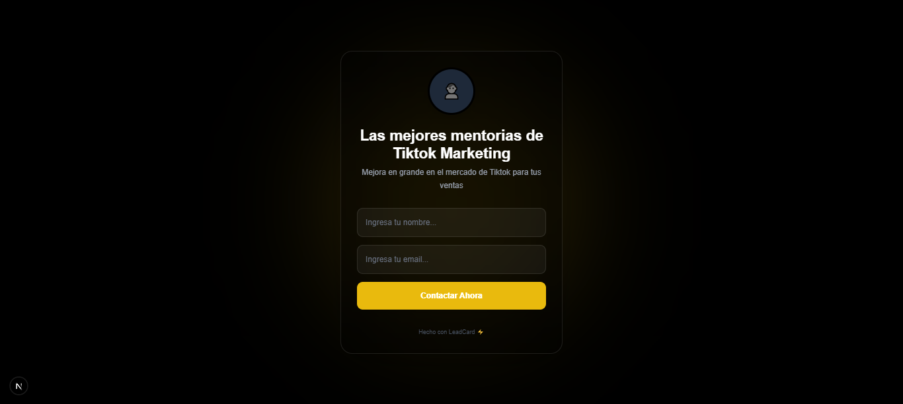

# LeadCard SaaS 🚀

**LeadCard** es una plataforma SaaS diseñada para freelancers y creadores de contenido que buscan una forma rápida, profesional y sin complicaciones de compartir su portafolio y captar leads.

Olvídate de servidores y configuraciones complejas. Crea tu tarjeta digital en segundos, comparte tu enlace único y recibe los datos de tus interesados directamente en un formato compatible con Excel.

---

## 📸 Demostración

### 1. Landing Page Principal

La puerta de entrada a la plataforma. Un diseño moderno con gradientes dinámicos y animaciones suaves para atraer a los usuarios.


### 2. Dashboard de Usuario

Donde ocurre la magia. Un panel intuitivo para gestionar tu perfil, ver tus leads capturados y descargar la información.


### 3. Tu LeadCard Pública

El resultado final. Una tarjeta digital optimizada para móviles donde tus visitantes pueden ver tu información y dejar sus datos de contacto.


---

## ✨ Características Principales

- **Neon Lakebase Postgres**: Base de datos serverless de alto rendimiento con branching y escalado a cero.
- **Neon Auth (Managed Better Auth)**: Autenticación integrada (Google OAuth y correo/contraseña) con gestión de sesiones en Postgres.
- **Captación de Leads Segura**: Formularios con endpoints protegidos sin exponer la base de datos al navegador.
- **Métricas y Visitas en Tiempo Real**: Agrupación y cálculo analítico ejecutado directamente en PostgreSQL.
- **Exportación a Excel / CSV**: Descarga todos tus contactos con un solo clic para gestionarlos como prefieras.
- **100% Personalizable**: Adapta los colores y estilos para que coincidan con tu marca personal.
- **Súper Rápido**: Construido con Next.js 16 (App Router) & React 19.

---

## 🛠️ Stack Tecnológico

Este proyecto ha sido construido con las últimas tecnologías web:

- **Framework**: [Next.js 16](https://nextjs.org/) (App Router & Turbopack) & [React 19](https://react.dev/)
- **Estilos**: [Tailwind CSS 4](https://tailwindcss.com/)
- **Base de Datos**: [Neon Lakebase Postgres](https://neon.tech/) vía `@neondatabase/serverless`
- **Autenticación**: [Neon Auth](https://neon.tech/docs/auth) vía `@neondatabase/auth`
- **Lenguaje**: [TypeScript](https://www.typescriptlang.org/)

---

## 🚀 Cómo Empezar (Desarrollo Local)

1. **Clonar el repositorio:**

   ```bash
   git clone https://github.com/dannfalcon33/leadcard-saas.git
   cd leadcard-saas
   ```

2. **Instalar dependencias:**

   ```bash
   npm install
   ```

3. **Vincular con Neon:**

   ```bash
   neon link
   ```
   Esto descargará automáticamente tus variables de entorno (`DATABASE_URL`, `NEON_AUTH_BASE_URL`, etc.) a `.env.local`.

4. **Aplicar migraciones:**

   ```bash
   npm run db:migrate
   ```

5. **Verificar conexión:**

   ```bash
   npm run db:check
   ```

6. **Correr el servidor de desarrollo:**

   ```bash
   npm run dev
   ```

7. Abre [http://localhost:3000](http://localhost:3000) en tu navegador.

---

## Sobre el Desarrollador 👨‍💻

**Yoshua Soto** (Dann Falcon Dev)  
_Fullstack Developer | Especialista en TypeScript_

Creador apasionado por construir aplicaciones que no solo funcionan, sino que asombran. Utilizando tecnologías web modernas y arquitecturas serverless, me enfoco en entregar experiencias de usuario memorables e inmersivas.

📫 **Contacto**

- **Email**: yoshuasoto54@gmail.com
- **WhatsApp**: +58 0422 033 1995

---


© 2026 Dann Falcon Media. Todos los derechos reservados.
